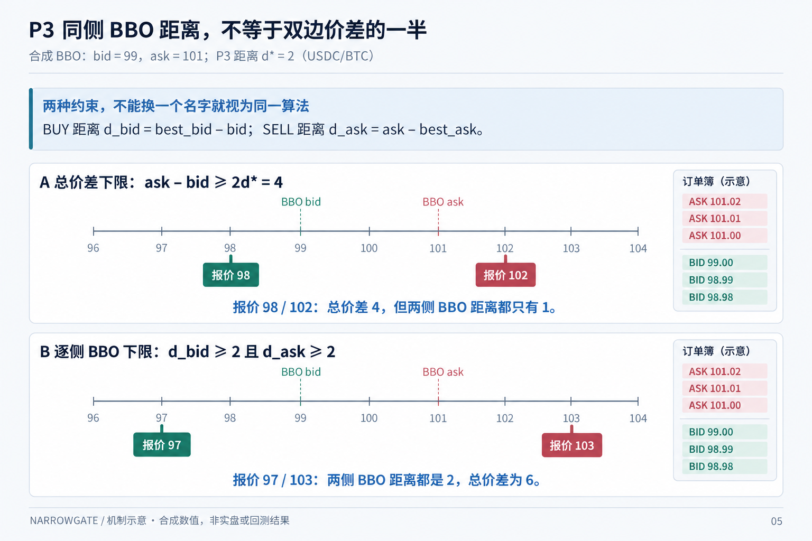

# F02：407 日新版研究

[English](README.md) | [简体中文](README.zh-CN.md)

Last materially modified: 2026-10-17

Last materially synchronized: 2026-10-17

## 研究问题与入口

本族负责[统一计划](../../RECOMPUTE_407.zh-CN.md)中的重算包 3, 6，详见[机器可读任务清单](../../recompute_407.json)。计划不是执行回执。

## 待验证问题

本族的[待验证问题](research_questions.json)由[研究族索引](../../registry.json)统一发现；扫描 `status=pending_validation` 即可找到：`F02-SCALAR-ADAPTER-CURRENT-SOURCE`。旧数值只保留在原报告中作为历史观察，不直接用于当前模型排名；来源不清或方法待重建要单独注明，不能把“无法核实”当成负结果。此清单不启动回测，也不改变正在运行的实验。

## 当前实现与新结果

静态 P3 已有训练内新输入适配；条件与 reach-time 曲面仍待集成。

这里尚未交付全量新研究结果；私有证据不随仓库分发。接口测试不能代替覆盖、样本/删失分母及预测→动作→订单→成交→库存→净收益证据。

## 输入、单位与评价

按统一 407 日来源与策略可见时钟，冻结特征/标签/动作单位、声明的候选、父产物和划分。不设回测次数配额，完成该问题需要的评价。按实际 outcome-end 剔除跨界标签；训练与选型不读最终集，保留 previous-use。共同初态、延迟、成交资格、费用、真实资金费和期末库存 MTM 必须固定；缺失不补零，意图不当成交。

## 复现与限制

P3 距离从同侧 BBO 向外计量，不是双边总价差的一半。最优买价 99、最优卖价 101 时，报价 98 / 102 的总价差为 4，但两侧同侧距离各只有 1；若距离各为 2，对应边界报价为 97 / 103。这个合成例子只区分约束对象，不代表经济表现或实现已经验收。

*机制示意 / 合成数值 / 非实盘或回测结果。双边总价差下限不等于逐侧 BBO 距离下限。*

从[新输入指南](../../INPUT_MIGRATION.zh-CN.md)选择实际接口，不默认读取旧模型、日期或排名。没有执行、输入不足、有效阴性与有效阳性分别记录。分叉状态不完整时不声称 checkpoint 等价；仿真不证明 native/live 成交一致。

## 已授权重做 scalar-adapter：方法复核

10月17日用户要求在当前数据和 B0 上重做8月 scalar-adapter 问题，旧经济结果不作为当前结论。原24日面板混合了9个已查看的 Validation-OOF 日期和15个后续诊断日期，并复用当时已有的条件模型，不是重新训练当前数据模型。双侧对称聚合，以及把10秒触达概率映射到报价下限和强度控制，都属于实质建模假设：触达不等于队列条件成交强度，也不等于净价值。负结果本身不能证明实现有错。

重做前须绑定当前输入、仅训练区间内的特征与校准支持、按实际结果终点去跨界及当前 B0。先按新身份重做原声明的标量映射，不暗中改成逐侧策略，也不针对旧亏损调参。分别报告信号、报价、成交、库存及完整净记账变化。目前已完成历史方法复核；新输入／模型绑定和新经济评价尚未完成。按用户要求，待新结果完整验收、保留依赖核实后再删除旧实验载荷。

## 历史背景

旧工作探索了本族机制，结论只属于其原始数据与执行身份。改写前树已保留一次私有快照；现存历史 docs 只供追溯，不作为当前关闭状态或重新开放最终集的依据。

## 待验证问题与已验收证据

旧结论已按问题统一登记到[研究族问题索引](research_questions.json)。扫描根研究族索引中的 `research_questions`，即可找到本族待验证项。此索引不启动实验；当前已验收结果和工程检查不因旧结论待验证而撤销。下列结果仍受各自数据、基线与覆盖范围约束。
